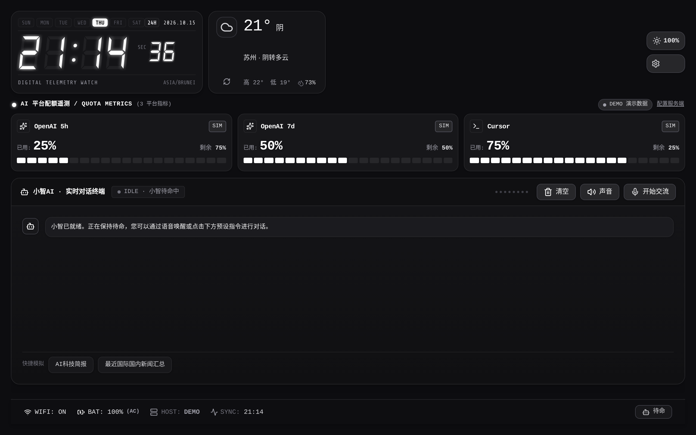
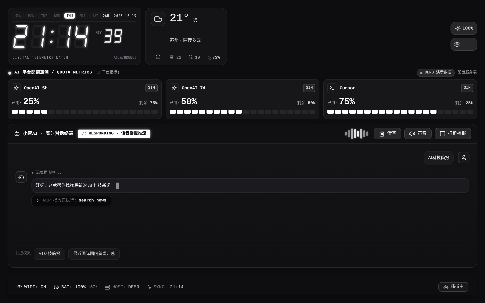
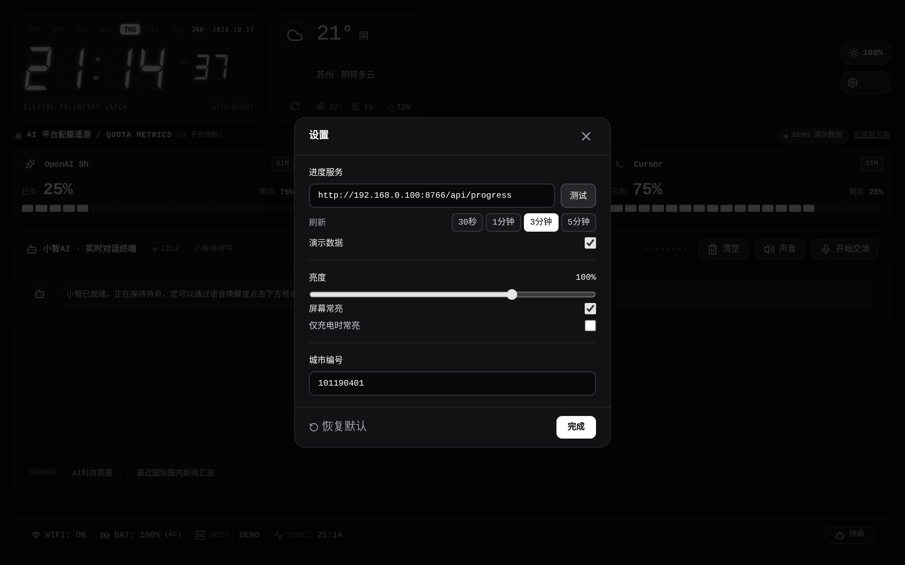
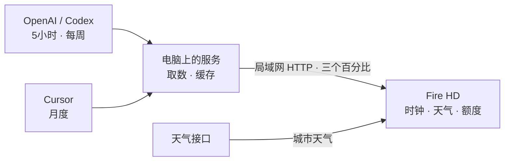

# AI Desk

**时间留在桌上，额度看一眼就够。**

一块 1280×800 的横屏，上半边是时钟、天气和 AI 配额，下半边是小智对话。密钥留在电脑上，平板只接收百分比和天气。

`Fire HD 8` · `1280×800` · `横屏常亮` · `Python 标准库`

[界面一览](#界面一览) ·
[数据怎么来到屏幕上](#数据怎么来到屏幕上) ·
[快速开始](#快速开始) ·
[目录](#目录)

> 配图使用演示数据。额度、天气和对话都是界面示例，不含真实账号、密钥或设备身份。进度接口与 [余刻 QuotaClock](https://github.com/akechi1980/QuotaClock) 相同。

## 横屏，刚刚好

不必把平板拿起来翻用量页面。电脑上的服务取回自己的账号额度，屏幕上只留下三个已使用百分比；时钟和天气一起常亮。

| 一眼看清 | 随手调整 |
| :--- | :--- |
| **七段时钟** · 时分秒、日期和星期 | **亮度** · 100% / 120% / 85% 循环，也可在设置里拖动 |
| **三行额度** · OpenAI 5 小时、每周、Cursor 月度 | **常亮** · 屏幕常亮，或只在充电时常亮 |
| **状态明确** · DEMO / SIM / LIVE，断线保留上次有效值 | **小智** · 语音或快捷指令，清空、静音、打断各自独立 |

## 界面一览

### 桌面 · 时钟、天气、额度在同一屏


主画面保持灰阶。三张卡从左到右是 OpenAI 5 小时、OpenAI 每周、Cursor 月度，条上的白块表示已使用比例。右上角 `DEMO` 表示本地演示；连上真实服务后变为 `LIVE`。服务返回测试数据时，卡片标为 `SIM`。

### 小智 · 对话留在下半屏



下半屏是对话。`开始交流` 之后才听麦克风；`停止录音` 结束这一句，`打断播报` 停掉正在说的话，文字还留着。`清空` 会同时打断并清掉这一轮。`声音` 只开关回复播报，不关麦克风。

快捷指令可以直接发出去。网页里的快捷回复是界面演示；装到平板上时，对话走小智服务。

### 设置 · 地址、刷新、亮度和城市



进度地址、刷新间隔、演示开关、亮度、常亮和城市编号都在这一页。`测试` 只检查当前地址能不能连通。城市编号用天气接口的城市代码，改完后天气按新的城市刷新。

## 数据怎么来到屏幕上



| 屏幕上的一行 | 含义 |
| :--- | :--- |
| `OpenAI 5h` | 5 小时窗口已使用比例 |
| `OpenAI 7d` | 每周窗口已使用比例 |
| `Cursor` | 月度额度已使用比例 |

屏幕认两种返回。

进度服务，默认端口 8766，与 [QuotaClock](https://github.com/akechi1980/QuotaClock) 的 `progress_service` 相同：

```json
{ "progress": [25, 50, 75], "simulation": false }
```

三个数依次是上面三行的已使用百分比。`simulation: true` 时界面标为 `SIM`。

伴侣服务，端口 8000，返回 `subscriptions`。每一项包含 `id`、`name`、`remaining`、`total`、`unit`、`status`。没有填写密钥时 `status` 为 `demo`。

请求失败时保留上一次的数字，不用 0% 冒充新数据。

> 额度来自各平台自己的接口，上游一改就可能失效。密钥放在电脑的 `server/config.json`，这个文件不进仓库。

## 快速开始

### 1 · 先在浏览器里看界面

```bash
npm install --legacy-peer-deps
npm run dev
```

打开 `http://localhost:3000`。设置里可以打开「演示数据」，不连服务也能看完整布局。

开发时，网页把 `/api/progress` 转到进度服务。进度服务本身不带跨域头，浏览器不要直接跨域去请求它。

### 2 · 在电脑上准备额度

两条路取一条。

**进度服务。** 使用 [QuotaClock](https://github.com/akechi1980/QuotaClock) 里的 `progress_service`，本机监听 `8766`。平板或网页填：

```text
http://电脑局域网IP:8766/api/progress
```

**伴侣服务。** 在本仓库启动：

```bash
python3 server/windows_agent_server.py
```

- 仪表盘：`http://127.0.0.1:8000/api/dashboard`
- 小智状态：`http://127.0.0.1:8000/api/xiaozhi/status`

真实密钥写在 `server/config.json`，字段对照 `server/config.example.json`。

| 字段 | 填写内容 |
| :--- | :--- |
| `deepseek_api_key` | DeepSeek 密钥 |
| `openai_api_key` | OpenAI 密钥 |
| `siliconflow_api_key` | 硅基流动密钥 |
| `cursor_session_token` | `WorkosCursorSessionToken` 的原始值 |

`config.json` 已被忽略。空着的平台继续显示演示数据，结果大约缓存 5 分钟。

### 3 · 让平板连上电脑

在平板设置里填写电脑的局域网地址，不要填 `localhost`。保存后先拉一次，再按所选间隔刷新。

网页和原生界面都认 `progress` 数组，也都认 `subscriptions`。

<details>
<summary>连不上时先看这几项</summary>

- 电脑上的服务还在不在：进度服务看 `/health`，伴侣服务看 `/api/dashboard`。进程活着不等于上游账号已经认证成功。
- 返回是不是 200，以及 `simulation` 是否符合预期。
- 平板和电脑是否在同一局域网，IP 有没有变，防火墙是否放行。这个项目不会改防火墙。
- 密钥是否过期。失败时旧数字会留着，所以屏幕上还有数，不代表刚刚更新成功。

</details>

### 装到 Fire HD

原生工程在 `android/`，包名 `com.aidesk.dashboard`。用 Android Studio 打开这个目录编译。`local.properties` 不进仓库，在本机写成自己的 SDK 路径。调试包名是 `com.aidesk.dashboard.debug`。

平板上打开 ADB：设置 → 设备选项 → 连点序列号，直到出现开发者选项 → 启用 ADB。安装后如需系统侧常亮：

```bash
adb shell settings put global stay_on_while_plugged_in 3
adb shell settings put system screen_off_timeout 2147483647
```

## 目录

```text
.
├─ src/                         网页桌面：时钟、天气、额度、小智
├─ server/windows_agent_server.py  伴侣服务，端口 8000
├─ server/config.example.json   密钥字段模板，不含真实密钥
├─ android/                     Fire HD 原生界面
├─ docs/images/                 本页配图，演示数据
└─ public/fonts/                界面用的等宽字体
```

## 使用注意

- **只放在可信局域网。** 页面和伴侣服务都没有登录。不要把端口转到公网。
- 仓库里没有真实密钥、会话令牌或设备身份。配图是演示数据。
- `server/config.json`、`android/local.properties`、密钥库和构建产物都不提交。

---

AI Desk · 一眼时间，一眼额度。
